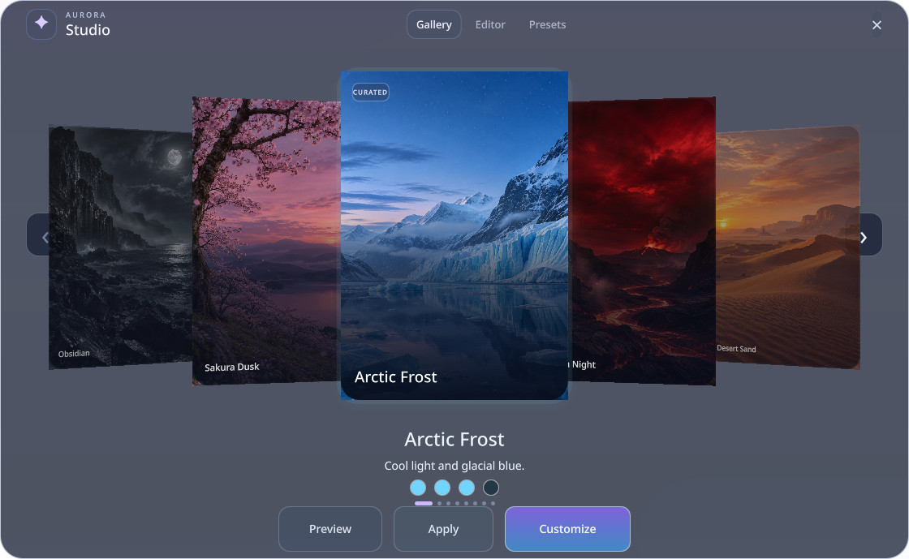

# Aurora Studio

Aurora Studio is a Qt Quick desktop theme manager for browsing and editing color presets. Its gallery presents the bundled themes in a layered cover-flow carousel with a translucent navy interface.



## Features

- Browse eight bundled presets with a keyboard- and mouse-driven cover-flow gallery.
- Preview theme palettes, descriptions, and bundled portrait artwork.
- Create, duplicate, edit, and delete user presets. Bundled presets remain immutable; editing one creates a user copy.
- Edit theme names, descriptions, and palette colors in the live editor.
- Save user presets as JSON in the platform's application data directory.
- Import and export validated Aurora theme JSON files.
- Preview themes inside Aurora Studio without changing desktop settings.
- Apply Alacritty colors after explicit confirmation, with an atomic backup, transaction recovery, and a visible restore action.
- Run the theme repository and bundled-theme validation tests with CTest.

## Build requirements

- CMake 3.21 or newer.
- A C++20 compiler.
- Qt 6 development packages for Quick, Quick Controls 2, Widgets, and Test.
- Python 3 for the bundled theme validation test.
- Ninja is recommended, though another CMake generator can be used.

On Debian or Ubuntu, the core packages are available with:

```sh
sudo apt install build-essential cmake ninja-build qt6-base-dev qt6-declarative-dev
```

Install the Qt Quick QML runtime modules required by your distribution if they are not installed with the Qt development packages.

## Build, test, and launch

From the project directory:

```sh
cmake -S . -B build -G Ninja
cmake --build build
ctest --test-dir build --output-on-failure
./build/aurora-studio
```

When a Wayland desktop session is active, `./build/qml-wayland-smoke` runs the gallery and dialog flow against that session and writes screenshots under `screenshots/`. It is intentionally a separate target from CTest so headless CI does not pretend to verify a real desktop.

The application can also be installed with CMake:

```sh
cmake --install build --prefix "$HOME/.local"
```

The build embeds the QML interface, bundled theme definitions, and SVG artwork in Qt resources. Installed builds do not depend on the source checkout. Installing the desktop entry also lets the freedesktop portal resolve the application ID used by the Wayland session.

## Theme data and artwork

Bundled preset definitions are in [`themes/`](themes/). The JSON schema contains palette values, terminal colors, descriptions, and integration metadata. User-created themes are stored under Qt's `AppDataLocation/themes` directory. Bundled JPEG previews and SVG wallpaper art are compiled into Qt resources. Existing persisted presets that refer to the bundled portrait files resolve to those resources.

The bundled JPEG previews and SVG artwork are in [`assets/`](assets/). The preview-art provenance is documented in [`assets/README.md`](assets/README.md). Wallpaper artwork is metadata only unless a supported wallpaper backend is added later.

## Desktop integrations

The gallery and Preview dialog never write desktop configuration. Apply shows the detected integration list and requires an explicit confirmation before changing anything.

| Component | Status | Behavior |
| --- | --- | --- |
| Alacritty | Supported | Adds one `import` for Aurora's managed `aurora-studio-colors.toml` and removes existing `[colors...]` tables so the imported palette takes effect. Other TOML settings are preserved. Config and include writes are atomic. Configurations with an existing unrelated import or an occupied Aurora include path are rejected without changes. New terminal windows read the new colors. |
| Restore Previous Theme | Supported | Keeps the exact pre-Apply Alacritty config and managed-include state in Qt's Aurora Studio application data directory. Repeated applies keep the original restore point; Restore writes them back atomically and verifies the config bytes. If either active file changed outside Aurora Studio after Apply, Restore stops to preserve those edits. |
| Interrupted apply | Supported | A transaction journal and per-apply before-images let the next Aurora Studio launch restore the preceding known-good Alacritty config and include state if a write was interrupted. |
| Hyprland | Unsupported | This environment's active configuration is DMS-owned Lua. Aurora Studio does not modify or reload that file, and no safe managed palette include was verified. |
| Wallpaper / DMS wallpaper selection | Unsupported | DMS owns wallpaper selection in the detected session, but this build has no verified external set-and-rollback interface. Per-monitor assignments are not changed. |
| DMS palette | Unsupported | DMS exposes seed-driven Matugen generation, not a verified API for applying an exact Aurora palette. Aurora Studio does not invoke Matugen. |
| GTK and Qt desktop appearance | Unsupported | No ownership-safe external appearance API was verified, so these settings remain unchanged. |

Application state and backups are stored under Qt's `AppDataLocation` for `aurora-studio` (typically `$XDG_DATA_HOME/aurora-studio/` or `~/.local/share/aurora-studio/`). If the previous configuration is moved or deleted outside Aurora Studio, restore reports a failure rather than claiming success.

## Current limitations

- Only Alacritty colors are applied. This does not change Hyprland borders, DMS widgets, wallpaper, GTK, Qt, or the whole desktop appearance.
- The active Alacritty TOML file must exist, have parseable table headers, and have no pre-existing `import` entry (unless it is Aurora Studio's own exact import). Application currently replaces Alacritty color tables as a unit, so custom entries inside `[colors...]` tables are replaced; all non-color settings remain intact and the complete original file is restorable.
- Aurora Studio does not reload Alacritty or restart any desktop service. New terminal windows use applied colors; existing windows may retain their current palette.
- Theme previews use bundled JPEG resources. Custom artwork can still be loaded from beside a persisted preset JSON file.
- Theme import and export support Aurora's JSON format only.
- The editor changes theme metadata and color values; it does not edit or generate artwork.

## Development roadmap

1. Add integrations only after a stable documented API and rollback path are verified for the detected desktop components.
2. Package theme data and assets so installed builds work without the source checkout.
3. Expand automated coverage for the QML gallery, responsive layouts, and import/export edge cases.
4. Explore additional theme integrations only where stable, documented interfaces are available.

## License and redistribution

No project-wide license is included yet. The repository previously contained no license or source provenance records, so the code and pre-existing SVG artwork have not been verified for release under MIT or another reuse license. Until a license is selected and ownership/provenance is confirmed, no project-wide permission to reuse, modify, or redistribute these files is granted. The generated portrait previews have separate provenance notes in `assets/README.md`; that does not settle the rights for the other project files.
